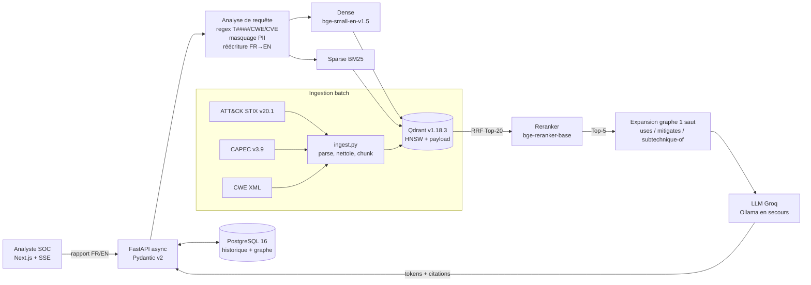

# ThreatLens

**Copilote RAG pour analystes SOC.** À partir d'un rapport de menace ou d'une description de CVE (FR ou EN), ThreatLens identifie les techniques **MITRE ATT&CK**, la faiblesse **CWE** en cause et les **mesures de protection**, avec des citations vérifiables.

Projet Fédérateur M2 AI-BD_BI — Polytech Intl, 2026-2027.

| Séance | Statut |
| --- | --- |
| S1 — Cadrage | Fiche de cadrage, backlog MoSCoW, choix de la base vectorielle (`docs/`) |
| S2 — Ingestion | Docker Compose, `scripts/ingest.py`, `scripts/search_test.py` |
| S3 à S7 | À venir |

## Architecture



Chaque réponse renvoie ses citations (`stix_id`, identifiant `T####` / `CWE-###`, extrait, score) pour le **Source Drawer**.

## Données (versions figées)

| Source | Version | Rôle | Licence |
| --- | --- | --- | --- |
| [MITRE ATT&CK Enterprise](https://github.com/mitre-attack/attack-stix-data) | v20.1 | Corpus | [ATT&CK Terms of Use](https://attack.mitre.org/resources/legal-and-branding/terms-of-use/) |
| [CAPEC](https://github.com/mitre/cti) | v3.9 | Corpus | Conditions d'utilisation MITRE |
| [CWE](https://cwe.mitre.org/data/downloads.html) | v5.0 (empreinte dans `data/MANIFEST.json`) | Corpus | Conditions d'utilisation MITRE |
| [CTIBench](https://huggingface.co/datasets/AI4Sec/cti-bench) | sha256 dans `data/MANIFEST.json` | Golden Dataset (jamais indexé) | CC BY-NC-SA 4.0 |

Les fichiers complets ne sont pas commités : `scripts/download_data.py` les télécharge et écrit leurs empreintes sha256 dans `data/MANIFEST.json`. Un échantillon est commité dans `data/raw/sample/`. L'échantillon `data/raw/sample/ctibench/` reste sous licence CC BY-NC-SA 4.0 (AI4Sec / CTIBench).

Corpus mesuré (`data/processed/ingest_report_threatlens_kb.json`) : **20 977 documents → 21 047 chunks**, dont 17 636 procedure examples et 968 CWE (CWE v5.0). 69 documents découpés. Ingestion complète en 37 min 30 s sur CPU, dont 93 % en embedding.

> CTIBench : Alam, M. T., Bhusal, D., Nguyen, L., Rastogi, N. *CTIBench: A Benchmark for Evaluating LLMs in Cyber Threat Intelligence.* NeurIPS 2024 Datasets and Benchmarks Track.

## Démarrage (Windows PowerShell)

Prérequis : Python 3.11+, Docker Desktop (WSL 2), Git, Node 20 (S5).

```powershell
git clone https://github.com/Samgalbi/threatlens.git
cd threatlens
python -m venv .venv
.\.venv\Scripts\Activate.ps1
pip install -r requirements-dev.txt
pip install -e .

Copy-Item .env.example .env     # puis remplir POSTGRES_PASSWORD (et DATABASE_URL)
docker compose up -d
docker compose ps               # les 2 services doivent être "healthy"

python scripts/download_data.py # environ 70 Mo
python scripts/ingest.py --recreate
python scripts/search_test.py --query "steal web browser cookies to hijack sessions" --category technique
```

Dashboard Qdrant : http://127.0.0.1:6333/dashboard

Tests (hermétiques, sans réseau ni modèle) :

```powershell
pytest
ruff check . ; ruff format --check .
```

## Structure

```
backend/app/core/        configuration (pydantic-settings)
backend/app/ingestion/   parseurs STIX/XML, nettoyage, chunking, indexation Qdrant
scripts/                 download_data, ingest, search_test, make_sample
tests/                   tests unitaires et d'indexation (Qdrant en mémoire)
docs/                    fiche de cadrage, backlog MoSCoW, choix de la base vectorielle
data/raw/sample/         échantillon commité ; data/raw/* complet ignoré par Git
```

## Équipe et responsabilités

| Membre | Rôle | Périmètre |
| --- | --- | --- |
| Samar Galbi | Lead Data / Retrieval, coordination | Ingestion, Qdrant, recherche hybride, reranker |
| Sahar Ayoub | Lead Backend / MLOps | FastAPI, SSE, PostgreSQL, Docker |
| Rim Mhirsi | Lead Frontend | Next.js, Source Drawer, carte ATT&CK, télémétrie |
| Wafa Manai | Lead Évaluation / Qualité | CTIBench, Ragas, tests, CI/CD, Kubernetes |

Dépôt : https://github.com/Samgalbi/threatlens

## Conventions

- Commits : [Conventional Commits](https://www.conventionalcommits.org/) (`feat:`, `fix:`, `test:`, `docs:`, `chore:`).
- Branche `main` protégée, merge par PR avec CI verte.
- Aucun secret dans Git : `.env` est ignoré, `.env.example` ne contient aucune valeur.
