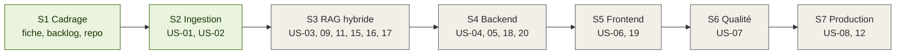

# Backlog Technique MoSCoW — ThreatLens
## User Stories et critères d'acceptation mesurables

> Gabarit : `Seance_01_Ideation_Cadrage_RAG/templates/matrice_moscow_backlog.md`. Les US-01 à US-14 du gabarit sont conservées et adaptées. Les US-15 à US-20 sont propres à ThreatLens.
> Règle de priorisation : **le socle Must Have doit être vert avant toute innovation Should Have.**

---

## 1. Vue d'ensemble

```mermaid
flowchart LR
    subgraph M["MUST · 8 stories · livraison S7"]
        direction TB
        m1["US-01 Ingestion et chunking"]
        m2["US-02 Index HNSW Qdrant"]
        m3["US-03 Hybride + reranker"]
        m4["US-04 API FastAPI + Pydantic v2"]
        m5["US-05 Streaming SSE + citations"]
        m6["US-06 Interface + Source Drawer"]
        m7["US-07 Tests + CI/CD"]
        m8["US-08 Docker multi-stage"]
    end
    subgraph S["SHOULD · 7 stories · forte valeur"]
        direction TB
        s1["US-09 Tracing par étape"]
        s2["US-11 Évaluation CTIBench + Ragas"]
        s3["US-15 Baseline sans RAG"]
        s4["US-16 Requête FR vers EN"]
        s5["US-17 GraphRAG 1 saut"]
        s6["US-18 Masquage PII"]
        s7["US-20 Plan de protection"]
    end
    subgraph C["COULD · 4 stories · différenciateurs"]
        direction TB
        c1["US-12 Kubernetes"]
        c2["US-19 Carte ATT#amp;CK"]
        c3["US-10 Cache Redis"]
        c4["US-13 Routage agentique"]
    end
    subgraph W["WON'T · hors périmètre"]
        direction TB
        w1["Fine-tuning d'un LLM"]
        w2["PDF multimodaux"]
        w3["SaaS, mobile"]
        w4["Actions automatiques"]
    end
    M ~~~ S ~~~ C ~~~ W

    classDef done fill:#EAF3DE,stroke:#3B6D11,color:#173404
    class m1,m2 done
    style M fill:#FCEBEB,stroke:#A32D2D,color:#501313
    style S fill:#FAEEDA,stroke:#854F0B,color:#412402
    style C fill:#E6F1FB,stroke:#185FA5,color:#042C53
    style W fill:#F1EFE8,stroke:#5F5E5A,color:#2C2C2A
```

Cases vertes : stories livrées (S2).

## 2. Feuille de route par séance

## 3. Synthèse

| Priorité | ID | User story | Critère clé (mesurable) | Séance | Statut |
| :-: | :-: | :--- | :--- | :-: | :-: |
| 🟥 Must | US-01 | Ingestion et chunking structuré | 21 047 chunks, payload complet, ré-ingestion idempotente (testée) | S2 | ✅ |
| 🟥 Must | US-02 | Index HNSW dense + BM25 dans Qdrant | Recherche 11–23 ms ; upsert par batch < 50 ms (à remesurer) | S2 | ✅ |
| 🟥 Must | US-03 | Hybride RRF + reranker Top-20 → Top-5 | Recall@5 ≥ 80 % sur CTIBench | S3 | ⏳ |
| 🟥 Must | US-04 | API FastAPI + Pydantic v2 | HTTP 422 sur entrée invalide, Swagger complet | S4 | ⏳ |
| 🟥 Must | US-05 | Streaming SSE avec citations | TTFT < 800 ms, historique PostgreSQL | S4 / S5 | ⏳ |
| 🟥 Must | US-06 | Interface + Source Drawer | Badges cliquables, bouton Stop, zéro rechargement | S5 | ⏳ |
| 🟥 Must | US-07 | Tests + CI/CD | Suite < 3 s, couverture ≥ 80 %, CI verte | S6 | ⏳ |
| 🟥 Must | US-08 | Docker multi-stage | Image backend < 350 Mo, USER 10001 | S7 | ⏳ |
| 🟧 Should | US-11 | Évaluation CTIBench + Ragas | Faithfulness ≥ 0,85, résultats versionnés | S3 | ⏳ |
| 🟧 Should | US-15 | Baseline sans RAG | Gain publié face à 22,9 % et au LLM seul | S3 | ⏳ |
| 🟧 Should | US-16 | Requête FR → EN | Comparée à un modèle multilingue sur 100 CVE | S3 / S4 | ⏳ |
| 🟧 Should | US-17 | GraphRAG 1 saut | Gain en micro-F1 et Context Recall | S3 / S4 | ⏳ |
| 🟧 Should | US-09 | Tracing par étape | Latence de chaque étape dans l'événement `done` | S3 / S4 | ⏳ |
| 🟧 Should | US-18 | Masquage PII / IOC | 10 cas de test, aucune IP interne envoyée | S4 | ⏳ |
| 🟧 Should | US-20 | Plan de protection priorisé | Précision@5 des mitigations ≥ 70 % | S4 | ⏳ |
| 🟦 Could | US-12 | Kubernetes | Ingress SSE, HPA, Secrets | S7 | ⏳ |
| 🟦 Could | US-19 | Carte ATT&CK colorée | 15 tactiques, clic = Source Drawer | S5 | ⏳ |
| 🟦 Could | US-10 | Cache sémantique Redis | Réponse < 50 ms si cosinus > 0,95 | — | ⏳ |
| 🟦 Could | US-13 | Routage agentique | Choix automatique de l'outil | — | ⏳ |

---

## 4. Détail des critères d'acceptation

### Must Have (livraison S7)

| ID | User Story | Critères d'acceptation (DoD) | Séance |
| :-: | :--- | :--- | :-: |
| **US-01** | **Ingestion et chunking structuré.** En tant que Data Engineer, je veux transformer ATT&CK (STIX), CAPEC et CWE (XML) en chunks enrichis pour indexer chaque objet avec sa provenance. | Script `scripts/ingest.py` asynchrone, une erreur de fichier n'arrête pas les autres. Payload : `doc_id`, `chunk_id`, `external_id`, `source` (avec version), `page`, `category`, `date`, `url`, `tactics`, `platforms`, `content`. Objets révoqués et dépréciés exclus. Ré-ingestion idempotente (même nombre de points après 2 exécutions, testé). | S2 |
| **US-02** | **Indexation vectorielle HNSW.** En tant que système RAG, je veux indexer vecteurs denses et sparse dans Qdrant pour une recherche rapide et filtrable. | Qdrant v1.18.3 via Docker Compose, volume nommé. Collection Cosine, HNSW `m=16`, `ef_construct=100`. Index de payload sur `category`, `tactics`, `platforms`, `external_id`. Upsert par batch de 64 avec latence p50/p95 publiée dans `ingest_report_*.json` (cible < 50 ms par batch, gabarit US-02). | S2 |
| **US-03** | **Retrieval hybride et reranking.** En tant que moteur de recherche, je veux fusionner dense et BM25 puis reranker pour remonter la bonne fiche même quand la requête cite un identifiant. | Top-20 hybride via RRF côté Qdrant (`k=60`), puis `bge-reranker-base` réduit au Top-5. **Recall@5 ≥ 80 %** sur cti-rcm. Tableau avant/après reranker dans `docs/fiche_evaluation_ia.md`. Reranker < 150 ms mesuré (ou écart justifié). | S3 |
| **US-04** | **API REST FastAPI + Pydantic v2.** En tant que client, je veux interroger une API typée et validée. | `QueryRequest` / `QueryResponse` / `CitationDTO` stricts. Rapport vide ou de plus de 20 000 caractères → HTTP 422. Swagger `/docs` sans schéma vide. `/health` vérifie Qdrant et PostgreSQL. | S4 |
| **US-05** | **Réponse en streaming SSE avec citations.** En tant qu'analyste, je veux voir la réponse arriver mot à mot avec ses sources. | `/api/v1/chat/stream`, événements `status`, `sources`, `token`, `done`. Chaque citation contient `stix_id`, `external_id`, extrait et score. **TTFT < 800 ms** (Groq). Historique enregistré dans PostgreSQL (SQLAlchemy 2.0 + asyncpg). | S4 / S5 |
| **US-06** | **Interface web réactive.** En tant qu'analyste, je veux coller un rapport et lire la réponse en streaming avec les sources cliquables. | Next.js 14 App Router + Tailwind. États idle / loading / error. Bouton Stop (AbortController). Badges `T####` / `CWE-###` qui ouvrent le **Source Drawer** (fiche d'origine + score). Bandeau TTFT, latence et confiance. Zéro rechargement. | S5 |
| **US-07** | **Qualité et CI/CD.** En tant que Lead Developer, je veux que chaque push lance lint, typage et tests sans coût. | Pytest + AsyncMock (LLM, Qdrant, PostgreSQL), **aucun appel réseau, suite < 3 s, couverture ≥ 80 %**. Ruff + Mypy + gitleaks dans GitHub Actions, CI verte bloquante sur `main`. | S6 |
| **US-08** | **Conteneurisation de production.** En tant qu'ingénieur DevOps, je veux lancer toute la pile en une commande, de façon sécurisée. | Dockerfiles multi-stage, **image backend < 350 Mo** (ONNX, sans PyTorch), USER 10001. `docker-compose.prod.yml` avec healthchecks. Secrets injectés uniquement par variables d'environnement. | S7 |

### Should Have (forte valeur, après le socle)

| ID | User Story | Critères d'acceptation | Séance |
| :-: | :--- | :--- | :-: |
| **US-09** | **Tracing par étape.** En tant que responsable IA, je veux connaître la latence de chaque étape. | Latence découpée (analyse de requête, embedding, dense, sparse, RRF, rerank, graphe, TTFT LLM) logguée et renvoyée dans l'événement `done`. Tokens consommés enregistrés. | S3 / S4 |
| **US-11** | **Évaluation continue (Golden Dataset CTIBench).** En tant que Data Scientist, je veux mesurer chaque variante du pipeline sur une vérité terrain réelle. | `scripts/evaluate.py` hors Pytest. Recall@k, MRR, accuracy CWE, micro-F1, Ragas (Faithfulness, Answer Relevance, Context Recall). `data/benchmark_golden.json` (≥ 15 triplets). Résultats versionnés dans `results/*.json`. Seeds fixés. | S3 |
| **US-15** | **Baseline sans RAG (anti-vibe-check).** En tant que jury, je veux voir le gain réel du RAG. | Même LLM, même prompt, sans contexte, sur cti-rcm 2021 et 2024. Écart publié avec la baseline majoritaire (22,9 %). | S3 |
| **US-16** | **Analyse de requête et réécriture FR → EN.** En tant qu'analyste francophone, je veux coller un rapport en français. | Extraction regex des `T####`, `CWE-###`, `CVE-####-#####`, `CAPEC-###`, conservés tels quels. Réécriture EN par le LLM. Comparaison chiffrée avec un modèle multilingue sur 100 CVE traduites. | S3 / S4 |
| **US-17** | **Expansion GraphRAG à 1 saut.** En tant qu'analyste, je veux les mitigations et sous-techniques liées aux techniques trouvées. | Relations `uses`, `mitigates`, `subtechnique-of` en base. Expansion limitée à 1 saut et N voisins. Gain en micro-F1 et en Context Recall mesuré face à « sans graphe ». | S3 / S4 |
| **US-20** | **Plan de protection priorisé (bloquer / détecter / corriger).** En tant qu'analyste SOC, je veux savoir quoi faire en priorité après l'analyse d'un rapport. | Mitigations classées par couverture pondérée : score(m) = Σ confiance(t) pour chaque technique détectée t que m atténue (relations `mitigates`). Trois volets : *Bloquer* (mitigations ATT&CK), *Détecter* (detection strategies / analytics), *Corriger* (mitigations CWE, parseur XML étendu). Chaque recommandation affiche sa justification (« couvre 3 techniques sur 4 ») et sa citation. **Aucun modèle entraîné, aucune action exécutée automatiquement.** Évaluation : précision@5 des mitigations proposées contre les `mitigates` des techniques de vérité (cti-ate), contrôle sur les questions « mitigation » de cti-mcq. | S4 |
| **US-18** | **Masquage PII / IOC.** En tant que RSSI, je veux qu'aucune donnée interne ne parte vers le LLM cloud. | IP, FQDN internes et e-mails remplacés par des jetons avant l'appel. Tests unitaires sur 10 cas. | S4 |

### Could Have (différenciateurs M2)

| ID | User Story | Critères d'acceptation |
| :-: | :--- | :--- |
| **US-12** | **Manifests Kubernetes** | Deployment, Service, Ingress Nginx (`proxy-buffering: off` pour le SSE), HPA et Secrets (pas de mot de passe dans une ConfigMap). |
| **US-19** | **Carte ATT&CK colorée** | Matrice des 15 tactiques, techniques détectées colorées par score, clic = Source Drawer. |
| **US-10** | **Cache sémantique Redis** | Similarité cosinus > 0,95 → réponse en < 50 ms, invalidation configurable. |
| **US-13** | **Routage agentique** | Router entre recherche documentaire, lookup exact d'un identifiant et requête SQL d'historique. |

### Won't Have (hors périmètre)

- Fine-tuning ou pré-entraînement d'un LLM.
- Ingestion de PDF de rapports multimodaux (images, schémas).
- Facturation SaaS, multi-tenant, application mobile native.
- Exécution automatique d'actions de réponse à incident (le copilote conseille, l'analyste décide).
