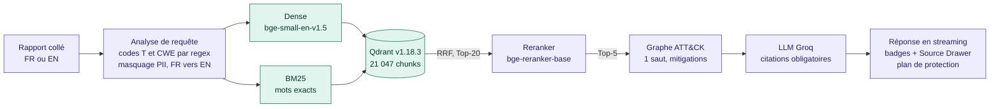

# ThreatLens — Pitch S1 (cadrage)

**Copilote RAG pour analystes SOC** · Samar Galbi · Sahar Ayoub · Rim Mhirsi · Wafa Manai · [github.com/Samgalbi/threatlens](https://github.com/Samgalbi/threatlens)

---

## 1. Le problème

> **Persona : analyste SOC niveau 1/2.** Pour chaque rapport de menace ou alerte CVE, il doit retrouver à la main parmi **706 techniques ATT&CK** celles qui sont utilisées, la **faille CWE** en cause et les **protections** à appliquer. C'est long et variable d'un analyste à l'autre, et les rapports arrivent souvent en français alors que les référentiels sont en anglais.

**Exemple.** Le rapport dit *« script PowerShell encodé lancé depuis une macro Word »*. La bonne réponse est **T1059.001** (PowerShell) et **T1566.001** (pièce jointe piégée).

| Approche | Ce qu'elle trouve | Ce qu'elle rate |
| --- | --- | --- |
| Mots-clés seuls (Ctrl+F, Elasticsearch) | Les identifiants exacts `T1059.001`, `CWE-79` | Le sens : synonymes, reformulations, rapport en français |
| Sens seul (embeddings) | « macro piégée » ≈ « Spearphishing Attachment » | Les identifiants : `T1059.001` et `T1059.003` se confondent |
| **Hybride + reranker (ThreatLens)** | **Les deux**, puis une vérification fine du Top-20 | — |

## 2. L'architecture

Vert : déjà en place (S2). Violet : séances 3 à 5.

**Pourquoi Qdrant :** dense + BM25 dans la même collection, fusion RRF native côté serveur, filtrage par métadonnées pendant le parcours HNSW, un seul conteneur. **Tout tourne sur CPU** (ONNX, sans PyTorch).

## 3. Les données

| Source | Version | Volume | Rôle |
| --- | --- | --- | --- |
| MITRE ATT&CK Enterprise | v20.1 | 706 techniques, 17 636 procedure examples | Corpus |
| CAPEC | v3.9 | 558 patterns | Pont CWE ↔ ATT&CK |
| CWE | v5.0 | 968 faiblesses | Corpus |
| **Total indexé** | | **20 977 documents → 21 047 chunks** | |
| CTIBench (CC BY-NC-SA 4.0) | sha256 figé | 1 000 + 1 000 CVE, 60 rapports, 2 500 QCM | **Golden Dataset, jamais indexé** |

## 4. Les métriques cibles

| Ce qu'on mesure | Métrique | Cible |
| --- | --- | :---: |
| La recherche trouve la bonne fiche | Recall@5 (CTIBench cti-rcm) | **≥ 80 %** |
| La réponse finale est juste | Accuracy CVE → CWE | **> baseline 22,9 %** et > LLM sans RAG |
| La réponse n'invente rien | Faithfulness (Ragas) | **≥ 0,85** |
| La réponse est pertinente | Answer Relevance (Ragas) | **≥ 0,80** |
| L'expérience est fluide | Premier token (TTFT) | **< 800 ms** |
| La recherche est rapide | Latence Qdrant | **11–23 ms** *(mesuré)* |

**Évaluation honnête :** progression mesurée variante par variante (sans RAG → dense → hybride → + reranker → + graphe), CTIBench jamais indexé, entités sources exclues pour éviter les fuites.

## 5. Le backlog en un coup d'œil

```mermaid
flowchart LR
    subgraph M["MUST · livraison S7"]
        direction TB
        m1["US-01 Ingestion et chunking"]
        m2["US-02 Index HNSW Qdrant"]
        m3["US-03 Hybride + reranker"]
        m4["US-04 API FastAPI + Pydantic v2"]
        m5["US-05 Streaming SSE + citations"]
        m6["US-06 Interface + Source Drawer"]
        m7["US-07 Tests + CI/CD"]
        m8["US-08 Docker multi-stage"]
    end
    subgraph S["SHOULD · forte valeur"]
        direction TB
        s1["US-11 Évaluation CTIBench + Ragas"]
        s2["US-15 Baseline sans RAG"]
        s3["US-16 Requête FR vers EN"]
        s4["US-17 GraphRAG 1 saut"]
        s5["US-20 Plan de protection"]
        s6["US-09 / US-18 Tracing, masquage PII"]
    end
    subgraph C["COULD · différenciateurs"]
        direction TB
        c1["US-12 Kubernetes"]
        c2["US-19 Carte ATT#amp;CK"]
        c3["US-10 Cache Redis"]
        c4["US-13 Routage agentique"]
    end
    M ~~~ S ~~~ C

    style M fill:#FCEBEB,stroke:#A32D2D,color:#501313
    style S fill:#FAEEDA,stroke:#854F0B,color:#412402
    style C fill:#E6F1FB,stroke:#185FA5,color:#042C53
```

**Won't Have :** fine-tuning d'un LLM, PDF multimodaux, SaaS / mobile, actions automatiques (le copilote conseille, l'analyste décide). Critères d'acceptation détaillés : [matrice_moscow_backlog.md](matrice_moscow_backlog.md).

## 6. Garde-fous

| Risque | Garde-fou |
| --- | --- |
| Hallucination | Citation obligatoire ; tout `T####` / `CWE` cité hors contexte est retiré |
| Fuite de données internes | IP, hôtes et e-mails masqués avant le LLM cloud ; mode Ollama 100 % local |
| Injection de prompt dans le rapport | Rapport délimité et traité comme donnée, jamais comme instruction |
| Secrets | `.env` uniquement, jamais commité ; ports liés à 127.0.0.1 |
